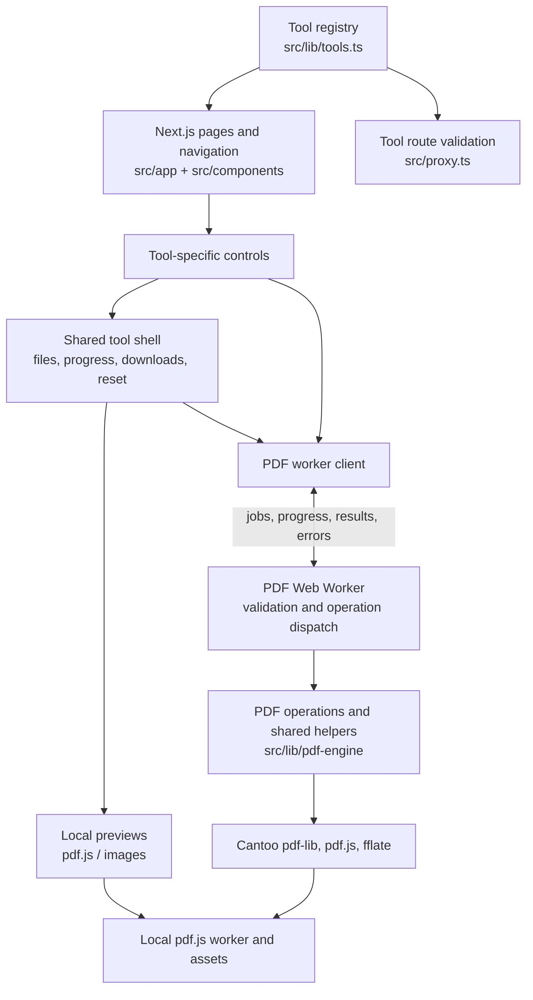

# Architecture

NoUploadPDF is a Next.js app whose PDF and image processing runs in the visitor's browser.
The server serves pages and assets; document data is not sent to it.

The registry defines fixed slugs, availability, and tool configuration. The tool route selects the
appropriate controls, while the shell manages selection, result URLs, cancellation, and cleanup.
The client transfers file buffers to the worker; the worker validates PDFs, runs one job at a time,
and transfers output buffers back. Watermark previews also use the worker; PDF thumbnails use pdf.js
in the browser. `scripts/prepare-pdfjs.mjs` copies pdf.js assets into `public/pdfjs` for development
and builds.

Vitest covers operations, worker messages, and UI behavior using fictional fixtures. Playwright tests
visitor flows and privacy requests; CI runs checks and tests pull requests against a Vercel preview.
Requirements, decisions, and outstanding verification live in the other files in `docs/`.
