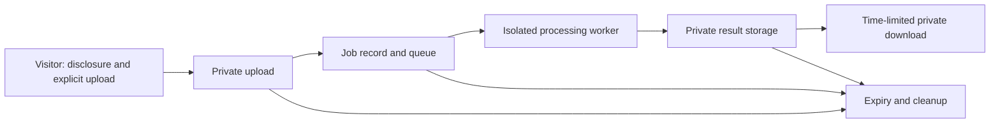

# Proposed server processing and launch plan

Status: **Proposal, not implemented or approved for launch.** [Decision 1](decisions.md#1-process-every-file-in-the-visitors-browser)
and the [current requirements](requirements.md) remain in force. [Decision 10](decisions.md#10-consider-an-explicit-server-path-for-heavy-pdf-jobs)
records the proposed change. Providers, prices, and several operating limits remain open.

## Visitor experience

The existing browser tools continue to process locally. OCR, PDF to Word, and stronger compression are
separate server-backed choices; a local operation never silently uploads or falls back to a server.
Before upload, explain that the file will leave the device, why, who processes it, the retention and deletion
policy, any limits and charges, and the tool's limitations. The visitor must explicitly start the upload.
Keep the experience usable without an account, with keyboard access and understandable status and errors.

- **OCR:** Produce a PDF with a searchable text layer over the original pages. Recognition can be inaccurate;
  language support and the treatment of existing text are launch decisions. Do not promise handwriting recognition.
- **PDF to Word:** Produce an editable Word document. Layout, fonts, images, tables, and reading order may change;
  scanned pages may require OCR. Explain what the selected implementation supports before processing.
- **Stronger compression:** Produce a smaller PDF when feasible, with disclosed image or quality tradeoffs.
  Show input and output sizes and offer the original if the output is not smaller. Preserve or explicitly reject
  signed documents rather than silently invalidating signatures; define other unsupported content before launch.

Provide uploading, queued, processing, ready, failed, cancelled, and expired states. Show measurable upload
progress and job progress only when trustworthy; otherwise show the current stage without invented percentages.
Explain how to retry a failure, that a link expires, and when the visitor must upload again. Provide cancel
and reset actions, and make clear that cancellation and deletion can take time to complete.

## Proposed lifecycle and safeguards

1. The application creates an opaque job identifier and separate high-entropy bearer credential for status,
   cancellation, and download authorization. Do not rely on an identifier alone. Scope upload authorization
   to one object, size, operation, and short lifetime. Validate size, type, PDF structure, and selected options
   server-side; a client-supplied filename or MIME type is not proof of validity.
2. Upload to non-public storage over TLS, using encryption at rest and separate least-privilege identities for
   the app, workers, and cleanup. Prevent public listing and cross-job access. Mark an upload complete only
   after validation, then enqueue a job that references the private object rather than carrying document bytes.
3. A worker claims the job with a lease and processes it in an isolated, non-privileged environment with bounded
   CPU, memory, disk, runtime, and network access. Treat files as untrusted; restrict outbound access, patch and
   review processing dependencies and licenses, and remove temporary files after every attempt.
4. Publish an output only after a successful attempt and authorization check. A download uses a short-lived,
   narrowly scoped capability and private storage; do not put credentials in logs, analytics, referrers, or
   support tickets. A bearer link can be shared by its holder, so explain that risk. Make link expiry no later
   than output expiry; enforce deletion separately because expiring a link does not delete an object.
5. A cleanup service and storage lifecycle rules remove inputs, outputs, partial uploads, temporary artifacts,
   and expired job records according to the approved retention policy. Sweep abandoned uploads and jobs even
   if the queue, worker, or normal completion path fails. Record deletion outcomes without document contents,
   retry failures, and alert on cleanup backlog. Define how replicas, backups, and provider-managed copies
   meet the same deletion commitment before launch.

Job state changes must be durable and conditional: retries or duplicate queue deliveries cannot publish two
results, resurrect a cancelled job, or extend retention. Use bounded retries for transient failures and terminal
errors for invalid or unsupported inputs. A lease timeout makes crashed work eligible for retry; an idempotent
completion step selects the winning output and cleans abandoned attempt artifacts. Cancellation prevents new
work and result publication, requests termination of active work, and schedules cleanup. It cannot recall a
download already delivered; already issued storage links may remain usable until they expire unless revoked.
Make that limitation explicit and choose link lifetimes accordingly. Once expired or deleted, report the result
as unavailable and require a fresh upload rather than exposing a stale link.

Limit upload size, page count, complexity, duration, queue depth, concurrent jobs, and per-client request rate;
apply quotas and spending limits before accepting work. Validate resource use during processing as well as at
upload. Protect endpoints against automated abuse without collecting document contents. Log only necessary
operational metadata with short retention and restricted access; exclude document data, filenames where possible,
bearer credentials, and download URLs. Metrics should cover queue age, failures, processing time, cleanup lag,
capacity, and spend, without document content or identifying labels.

## Going live

Launch is blocked until the proposed decision is accepted and decision 1, requirements, and all affected
product claims are revised. Home, About, tool pages, FAQs, privacy notices, and download copy must distinguish
local processing from uploads; the name NoUploadPDF must also be reviewed for whether it remains truthful.
Publish actual retention and subprocessors, and get legal review of privacy, terms, data handling, applicable
jurisdictions, and any paid offering. Do not promise a deletion deadline that infrastructure cannot meet.

- Assign an operational owner, support contact, and incident lead. Define incident response, document exposure
  reporting, secret rotation, provider escalation, and a procedure to suspend uploads and downloads.
- Set service targets, alerts, on-call response, capacity and spend alarms, and limits that fail closed when
  capacity or budget is exhausted. Establish dashboards without sensitive data and rehearse an incident.
- Choose deployment environments and isolated credentials; test staged rollout, feature disablement, rollback,
  migrations, and recovery from worker, queue, storage, and application failures. Decide which metadata needs
  backup and how recovery interacts with deletion; avoid retaining document backups beyond the stated policy.
- Verify the full flow using fictional documents: disclosure and explicit upload, private access, all states,
  output correctness, cancellation races, retries, duplicate deliveries, expiry, cleanup failures, and recovery.
  Test keyboard and narrow-screen use, abuse limits, and network behavior for both local and server tools.
- Complete provider and dependency security, licensing, privacy, data residency, and cost review; exercise
  cleanup and verify deletion against the selected storage and backup configuration. Complete CI and preview
  checks and a controlled launch review before enabling public traffic.

## Open decisions

Resolve and document these before launch; no provider or price is selected by this plan.

| Decision | What to settle |
| --- | --- |
| Providers and processing software | Hosting, private storage, queue, worker platform, OCR, Word conversion, and compression engines; self-hosting versus managed processing; licenses and subprocessors. |
| Prices and business model | Actual provider quotes, fixed and per-job costs, bandwidth and cleanup costs, traffic assumptions, free or paid access, spending caps, and funding. |
| Retention and access | Input, output, incomplete upload, job metadata, log, and backup lifetimes; link lifetime; deletion and cancellation guarantees. |
| Limits and targets | File size, pages, job duration, concurrency, retry policy, queue capacity, rate limits, availability, latency, cleanup deadlines, and response ownership. |
| Tool behavior | OCR languages and existing-text handling, scanned PDF to Word support, compression quality and document compatibility, signed and encrypted input policy. |
| Trust and compliance | Applicable jurisdictions, data location, legal terms, privacy disclosures, provider contracts, threat review, and brand naming. |

Compare candidates against privacy and deletion guarantees, isolation and access controls, supported operations
and output quality, reliability, data residency, licensing, operational complexity, portability, and measured
cost at expected and peak usage. Test representative fictional documents and failure scenarios before choosing.

## Proposed small issues

These are planning items, not existing tasks or externally created tickets. Complete the gates before enabling
the affected work; later issues may be split further as provider and product decisions are made.

1. **Resolve the product and privacy gate.** Deliverable: accepted or rejected decision and revised promise.
   Acceptance: decision 1, requirements, product naming, local/server boundaries, and legal review are resolved.
2. **Evaluate engines and providers.** Deliverable: comparison and fictional-document trials. Acceptance:
   processing quality, licenses, isolation, deletion, data location, portability, and cost evidence are recorded.
3. **Set operating limits and funding.** Deliverable: approved budget and service limits. Acceptance: prices,
   quotas, retention, supported languages, service targets, and owners are recorded with no unresolved launch gates.
4. **Define the job and authorization contract.** Deliverable: job states, transitions, credentials, and API
   contract. Acceptance: expiry, cancellation, retries, duplicate delivery, and access isolation are specified.
5. **Build private uploads.** Deliverable: scoped upload and validation flow. Acceptance: unauthorized, oversized,
   malformed, and abandoned uploads are rejected or cleaned up; no public object access exists.
6. **Build durable queue and worker isolation.** Deliverable: bounded job execution and retries. Acceptance:
   crash recovery, lease expiry, duplicate execution, cancellation, and resource limits pass integration tests.
7. **Build OCR processing.** Deliverable: searchable PDF output. Acceptance: supported languages and known
   limitations are disclosed; fictional scanned outputs reopen and contain searchable text.
8. **Build PDF to Word processing.** Deliverable: editable Word output. Acceptance: fictional text and layout
   cases reopen in a Word-compatible reader, and unsupported cases return actionable errors.
9. **Build stronger compression.** Deliverable: server compression with size comparison. Acceptance: quality
   tradeoffs and signatures are handled as specified and the original is offered when output is not smaller.
10. **Build private downloads and cleanup.** Deliverable: scoped expiring access and deletion sweeps. Acceptance:
    cross-job access fails and completed, failed, cancelled, abandoned, and partial artifacts expire as promised.
11. **Add visitor controls and disclosures.** Deliverable: accessible upload, progress, cancellation, errors,
    download, and privacy copy. Acceptance: no upload precedes explicit action; keyboard and narrow layouts work.
12. **Prepare operations and launch review.** Deliverable: monitoring, spending controls, runbooks, rollout,
    rollback, incident and recovery rehearsals. Acceptance: alerts and end-to-end tests pass, owners sign off,
    and privacy, legal, provider, budget, and deletion gates are closed before public enablement.
